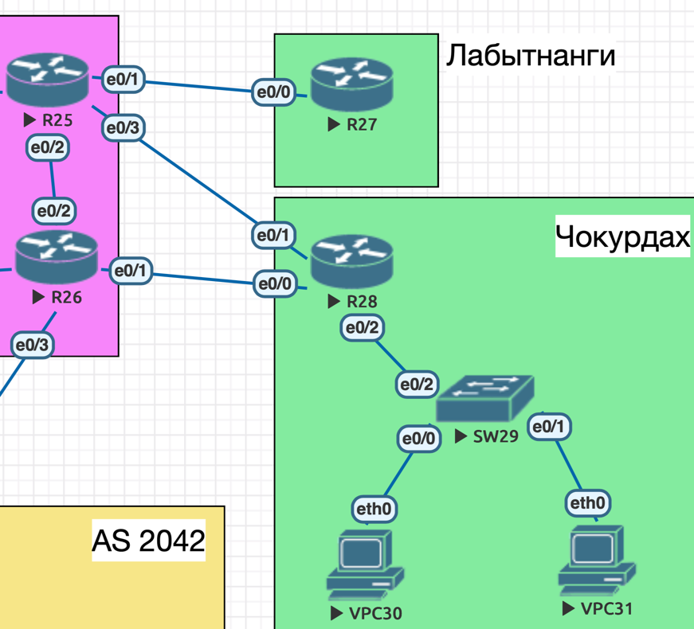
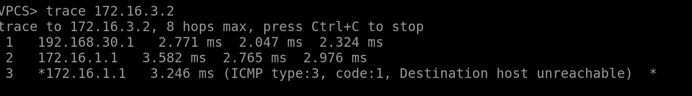
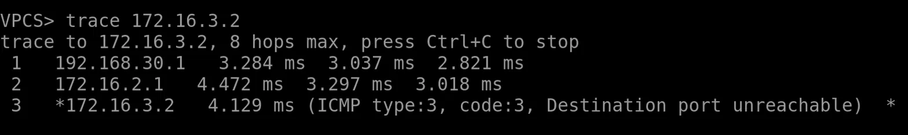
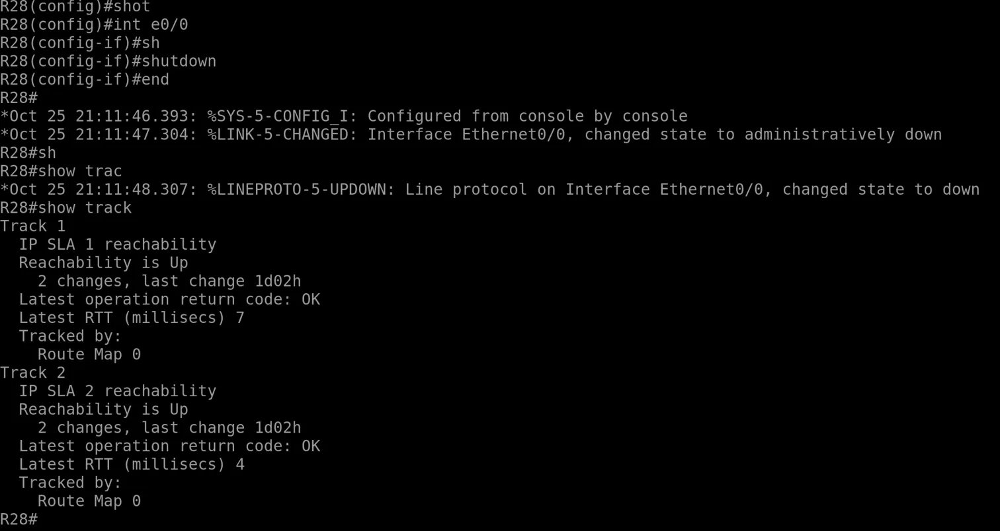
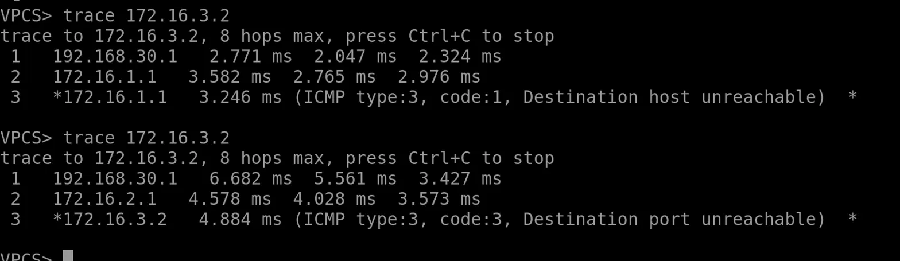

# Маршрутизация на основе политик (PBR)

## Домашнее задание

Цель: настроить политику маршрутизации в офисе Чокурдах и распределить трафик между двумя линками.

- Настроите политику маршрутизации для сетей офиса.
- Распределите трафик между двумя линками с провайдером.
- Настроите отслеживание линка через технологию IP SLA.(только для IPv4)
- Настройте для офиса Лабытнанги маршрут по-умолчанию.
- План работы и изменения зафиксированы в документации.

### Решения:

1. Исходные данные и план работы
   - Схема сети
   - Таблица адрессации
2. Маршрутизация на основе политик PBR
   - Пример настройки PBR
3. IP SLA
4. Офис Лабытнанги: маршрут по умолчанию
### 1. Исходные данные и план работы


#### Схема сети 



Офис Чокурдах: маршрутизатор R28 имеет два линка к провайдеру (e0/0 и e0/1) и один порт (e0/2) в сторону коммутатора SW29.
К SW29 подключены VPC30 (e0/0) и VPC31 (e0/1).

Офис Лабытнанги: маршрутизатор R27 с одним линком к провайдеру (e0/0).

#### Таблица адресации

| Устройство | Интерфейс | IPv4 | Шлюз | Комментарий |
|------------|-----------|------|------|-------------|
| R28 | e0/0 | 172.16.1.2/24 | - | линк к ISP1 (R26 e0/1) |
| R28 | e0/1 | 172.16.2.2/24 | - | линк к ISP2 (R25 e0/3) |
| R28 | e0/2 | 192.168.30.1/24 | - | шлюз сети офиса, в сторону SW29 |
| R26 (ISP1) | e0/1 | 172.16.1.1/24 | - | линк к R28 |
| R25 (ISP2) | e0/3 | 172.16.2.1/24 | - | линк к R28 |
| R25 (ISP2) | e0/1 | 172.16.3.1/24 | - | линк к R27 |
| R27 | e0/0 | 172.16.3.2/24 | - | линк к R25 (ISP2) |
| VPC30 | eth0 | 192.168.30.100/24 | 192.168.30.1 | |
| VPC31 | eth0 | 192.168.30.110/24 | 192.168.30.1 | |

### 2. Маршрутизация на основе политик PBR

#### Пример настройки PBR

```
conf t
 ip access-list extended VPC30
  permit ip host 192.168.30.100 any
  exit
 ip access-list extended VPC31
  permit ip host 192.168.30.110 any
  exit
!
 route-map PBR-CHOKURDAH permit 10
  match ip address VPC30
  set ip next-hop 172.16.1.1
  exit
 route-map PBR-CHOKURDAH permit 20
  match ip address VPC31
  set ip next-hop 172.16.2.1
  exit
!
 interface Ethernet0/2
  ip policy route-map PBR-CHOKURDAH
  exit
 exit
```

### 3. IP SLA

### Пример настройки PBR с IP SLA

```
conf t
 ip sla 1
  icmp-echo 172.16.1.1 source-interface Ethernet0/0
  frequency 5
  exit
 ip sla schedule 1 life forever start-time now
!
 ip sla 2
  icmp-echo 172.16.2.1 source-interface Ethernet0/1
  frequency 5
  exit
 ip sla schedule 2 life forever start-time now
!
 track 1 ip sla 1 reachability
 track 2 ip sla 2 reachability
!
 route-map PBR-CHOKURDAH permit 10
  match ip address VPC30
  set ip next-hop verify-availability 172.16.1.1 1 track 1
  set ip next-hop verify-availability 172.16.2.1 2 track 2
  exit
 route-map PBR-CHOKURDAH permit 20
  match ip address VPC31
  set ip next-hop verify-availability 172.16.2.1 1 track 2
  set ip next-hop verify-availability 172.16.1.1 2 track 1
  exit
 exit
```

### 4. Офис Лабытнанги: маршрут по умолчанию

```
conf t
 interface Ethernet0/0
  ip address 172.16.3.2 255.255.255.0
  no shutdown
  exit
 ip route 0.0.0.0 0.0.0.0 172.16.3.1
 exit
```

### 5. Проверка

##### VPC30


#### VPC31



Трафик VPC30 уходит на ISP1 , VPC31 уходит на ISP2

На R28 отключается интерфейс e0/0:

```
conf t
 interface Ethernet0/0
  shutdown
  end
```

Через несколько секунд тест IP SLA 1 перестаёт получать ответы, и track 1 переходит в состояние Down:

```
show track
```



Повторная отправка пакета с VPC30 показывает, что трафик ушёл на резервный линк: хоп 2 теперь 172.16.2.1 (ISP2), трасса доходит до R27.

